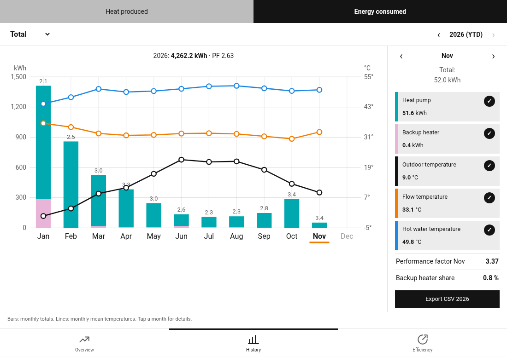
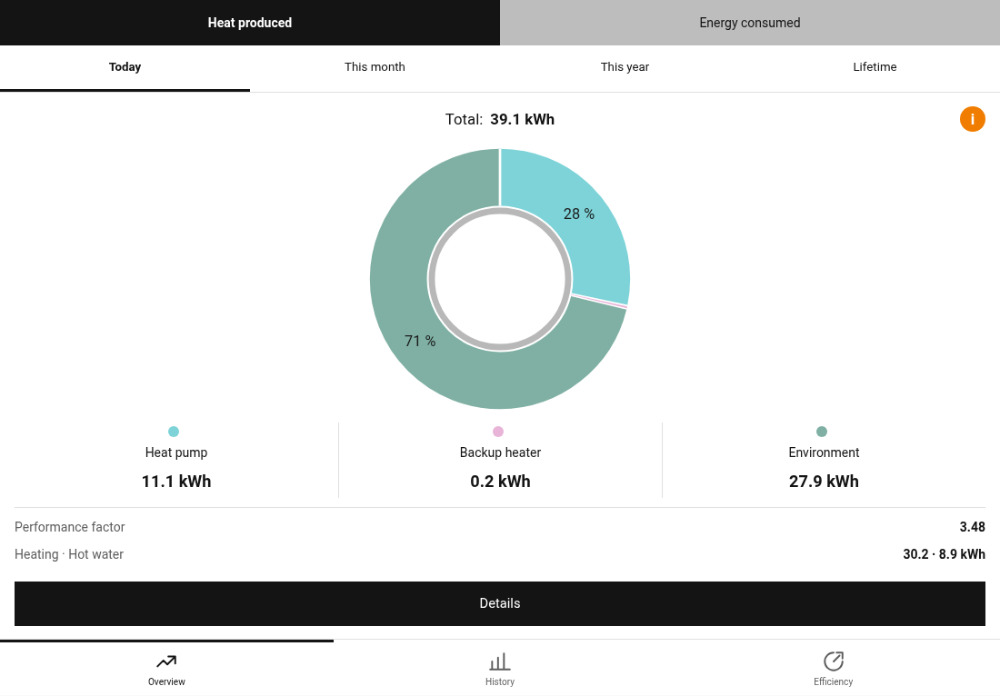
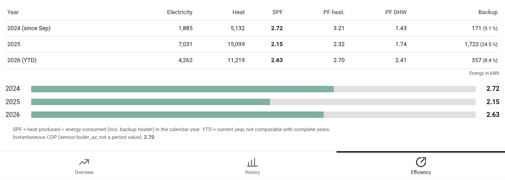
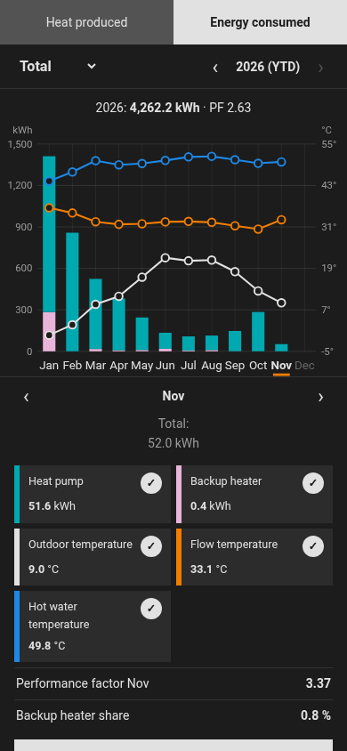

# EMS-ESP Heat Pump Energy Card

A Home Assistant dashboard card for heat pumps connected through [EMS-ESP](https://emsesp.org).
It shows the electricity consumed, the heat produced, the environmental energy and the
performance factors for today, the current month, any calendar year and the whole lifetime of the
heat pump. It also has monthly charts with outdoor, flow and hot water temperatures.

The card reads only Home Assistant's own long-term statistics. It needs no cloud access and no
extra helpers, template sensors or `utility_meter`s, and it never controls the heat pump.

*Deutsche Kurzfassung weiter unten.*



## Screenshots

| Overview | Efficiency | Phone, dark theme |
|---|---|---|
|  |  |  |

Screenshots from the test installation (Buderus WLW186i, Home Assistant language set to English).

## Features

- **Overview:** heat produced or energy consumed for today, this month, this year or the lifetime,
  as a donut chart split into heat pump, backup heater and environment.
- **History:** monthly bars from January to December with year navigation, split into total,
  heating or hot water. It adds the monthly mean outdoor, flow and hot water temperatures, a
  performance factor per month and a CSV export.
- **Efficiency:** seasonal performance factor (SPF) per calendar year for total, heating and hot
  water, plus the backup heater's share. The current year is marked *YTD*.
- English and German UI. Numbers and month names follow the Home Assistant user's language.
- Works in light and dark themes and on phones and desktops.
- Fast: closed months are cached per Home Assistant user (see [Caching](#caching-and-privacy)).

## Requirements

- EMS-ESP with Home Assistant MQTT discovery. The default entity IDs are the ones EMS-ESP creates
  for the `boiler` device of a heat pump (for example `sensor.boiler_meter_compressor`). Other IDs
  can be configured.
- The energy sensors must have `state_class: total_increasing` and the temperature sensors
  `state_class: measurement`, so that the recorder keeps long-term statistics for them.
  EMS-ESP does this by default.

Tested with Home Assistant 2026.10 and a Buderus Logatherm WLW186i with an MX300 gateway. Other
EMS heat pumps that expose the same counters should work, but have not been verified.

## Installation

### HACS (custom repository)

1. HACS → ⋮ → *Custom repositories* → add `https://github.com/prapse/ems-esp-heatpump-energy-card`
   with the type *Dashboard*.
2. Install *EMS-ESP Heat Pump Energy Card* and reload the browser.

### Manual

1. Copy `dist/ems-esp-heatpump-energy-card.js` to `/config/www/`.
2. Settings → Dashboards → ⋮ → *Resources* → add `/local/ems-esp-heatpump-energy-card.js?v=1.0.0`
   as a *JavaScript module*. Increase `?v=` with every update, because browsers cache `/local/` files.

### Add the card

```yaml
type: custom:ems-esp-heatpump-energy-card
```

The card works best on its own dashboard view of type *Panel*.

## Configuration

| Option | Default | Description |
|---|---|---|
| `entities` | EMS-ESP defaults | Overrides of the statistic IDs, see below. Set one to `null` to disable it. |
| `start` | detected | First month to show, `"YYYY-MM"`. By default the card finds the first month with data. |
| `default_view` | `history` | `overview`, `history` or `efficiency` |
| `default_kind` | `electric` | `electric` (energy consumed) or `heat` (heat produced) |
| `default_circuit` | `total` | `total`, `heating` or `dhw` |
| `cop_entity` | `sensor.boiler_az` | Instantaneous COP shown on the efficiency view; `null` hides it. |
| `low_heat_kwh` | `30` | Months with less heating heat get their heating PF flagged as not meaningful. |
| `show_header` | `false` | Show a header with `title` and `subtitle`. |
| `refresh_minutes` | `5` | How often today's and this month's values are reloaded. |
| `debug` | `false` | Show the version and loading time. |

Entity keys and their defaults:

| Key | Default | Meaning |
|---|---|---|
| `eCompressor` | `sensor.boiler_meter_compressor` | Compressor electricity, heating + hot water |
| `eCompHeating` | `sensor.boiler_meter_heating` | Compressor electricity, heating |
| `eAux` | `sensor.boiler_meter_e_heater` | Backup heater electricity, total |
| `eAuxDhw` | `sensor.boiler_dhw_aux_elec_heater_energy_consumption` | Backup heater electricity, hot water |
| `qTotal` | `sensor.boiler_total_energy` | Heat produced, total |
| `qHeating` | `sensor.boiler_energy_heating` | Heat produced, heating |
| `qDhw` | `sensor.boiler_dhw_energy` | Heat produced, hot water |
| `eCompDhw` | `sensor.boiler_dhw_meter` | Compressor electricity, hot water (plausibility check only) |
| `eTotal` | `sensor.boiler_meter_total` | Electricity total (plausibility check only) |
| `tOutside` | `sensor.boiler_outside_temperature` | Outdoor temperature |
| `tFlow` | `sensor.boiler_current_flow_temperature` | Flow temperature |
| `tDhw` | `sensor.boiler_dhw_current_intern_temperature` | Hot water tank temperature |

Example with a different outdoor sensor and without the plausibility counters:

```yaml
type: custom:ems-esp-heatpump-energy-card
entities:
  tOutside: sensor.garden_temperature
  eCompDhw: null
  eTotal: null
```

## How values are calculated

For a period, Δx is the increase of counter x (statistic type `change`).

| Figure | Formula |
|---|---|
| Energy consumed | Δ`eCompressor` + Δ`eAux` |
| … heating | Δ`eCompHeating` + (Δ`eAux` − Δ`eAuxDhw`) |
| … hot water | (Δ`eCompressor` − Δ`eCompHeating`) + Δ`eAuxDhw` |
| Heat produced | Δ`qTotal`, split into Δ`qHeating` and Δ`qDhw` |
| Environment | heat produced − energy consumed |
| Performance factor | heat produced ÷ energy consumed for the same period and circuit |
| Backup heater share | Δ`eAux` ÷ energy consumed |

Notes:

- **The heat counters include the backup heater's heat.** The backup heater therefore counts in
  the denominator of the performance factor, and environmental energy is not overstated. On the
  test installation, today's, this month's and this year's values matched the manufacturer's app
  to within 0.5 kWh.
- **Energy consumed is built from compressor + backup heater, not from `eTotal`.** After a gap in
  the Home Assistant statistics, the long-term statistics of `eTotal` lost a jump of about 60 kWh,
  while the partial counters kept it. `eTotal` is only used as a cross-check.
- Temperatures in the charts are **monthly means** from the statistics, not current readings.
- The *Lifetime* view uses the current counter states, so it includes energy from before Home
  Assistant started recording.
- In summer the heating counter can keep increasing (standby and pump power) while hardly any
  heating heat is produced. That gives very low heating PFs; such months are flagged.
- The performance factors are period values. The instantaneous COP (`cop_entity`) is shown
  separately and is not used in any calculation.

## Caching and privacy

Loading all months from the recorder can take tens of seconds on a large database, so the card
caches **closed months** in Home Assistant's per-user frontend storage (`frontend/user_data`, key
`ems_esp_hp_energy_card`). This data stays on your Home Assistant server and can only be read by
a logged-in user. It is not stored in `/config/www`, because files there can be read without
logging in. A month is cached 3 hours after it ends. *reload* in the info box (ⓘ) rebuilds the
cache, and changing an entity invalidates it. With a full cache, the card loads in well under a
second.

## Development

There are no dependencies, only Node.js ≥ 20.

```sh
node build.mjs     # writes dist/ems-esp-heatpump-energy-card.js
npm test           # model tests and a smoke test of the bundled card
```

`dist/` is committed, so HACS can install from a tag. CI checks that it matches `src/`.

## Disclaimer

This is a community project. It is not affiliated with or endorsed by Bosch, Buderus or the
EMS-ESP project. Brand names are used only to describe compatibility.

---

## Deutsch (Kurzfassung)

Dashboard-Karte für Home Assistant: Sie zeigt Stromverbrauch, erzeugte Wärme, Umweltenergie und
Arbeitszahlen einer über EMS-ESP angebundenen Wärmepumpe, für heute, den laufenden Monat, jedes
Kalenderjahr und die gesamte Laufzeit. Dazu kommen Monatsdiagramme mit Außen-, Vorlauf- und
Warmwassertemperatur, Jahresarbeitszahlen und CSV-Export. Datenquelle ist ausschließlich die
Langzeitstatistik von Home Assistant, ohne Cloud und ohne zusätzliche Hilfssensoren.

- **Installation:** HACS → *Benutzerdefinierte Repositories* → diese URL als *Dashboard* hinzufügen,
  danach die Karte `type: custom:ems-esp-heatpump-energy-card` einfügen.
- **Sprache:** Die Oberfläche ist Deutsch, wenn der HA-Benutzer Deutsch eingestellt hat.
- **Berechnung:** Verbrauchte Energie = Verdichter + Zuheizer. Erzeugte Wärme = Wärmemengenzähler
  (enthält die Zuheizer-Wärme). Umwelt = Wärme − Strom. Arbeitszahl = Wärme ÷ Strom im Zeitraum.
  Auf der Testanlage (Buderus WLW186i mit MX300) stimmen die Werte auf ≤ 0,5 kWh mit der
  Buderus-App überein.
- **Cache:** Abgeschlossene Monate liegen pro Benutzer im HA-Frontend-Speicher, nur angemeldet
  erreichbar. Mit vollem Cache lädt die Karte in unter einer Sekunde.
